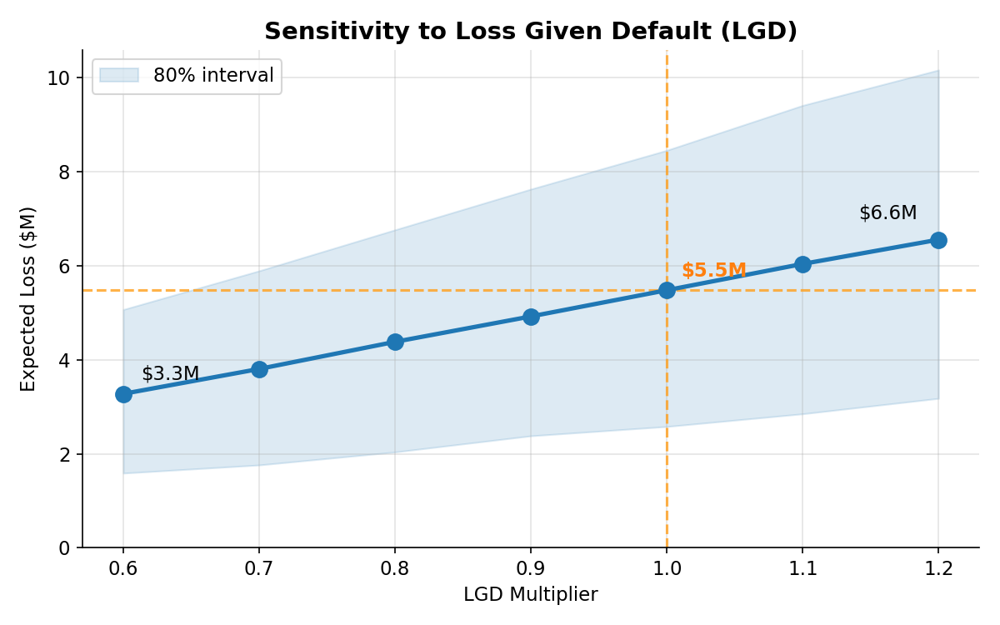
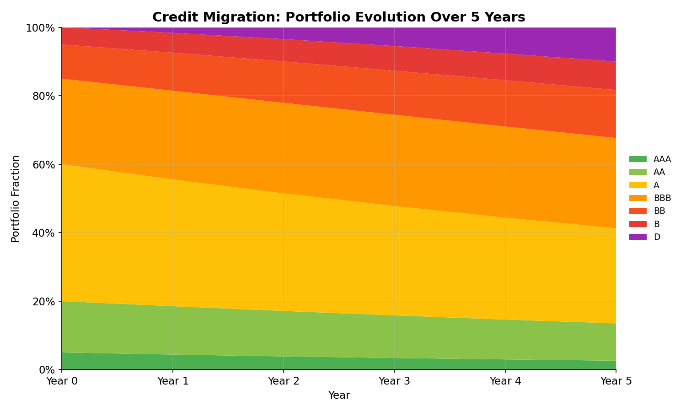
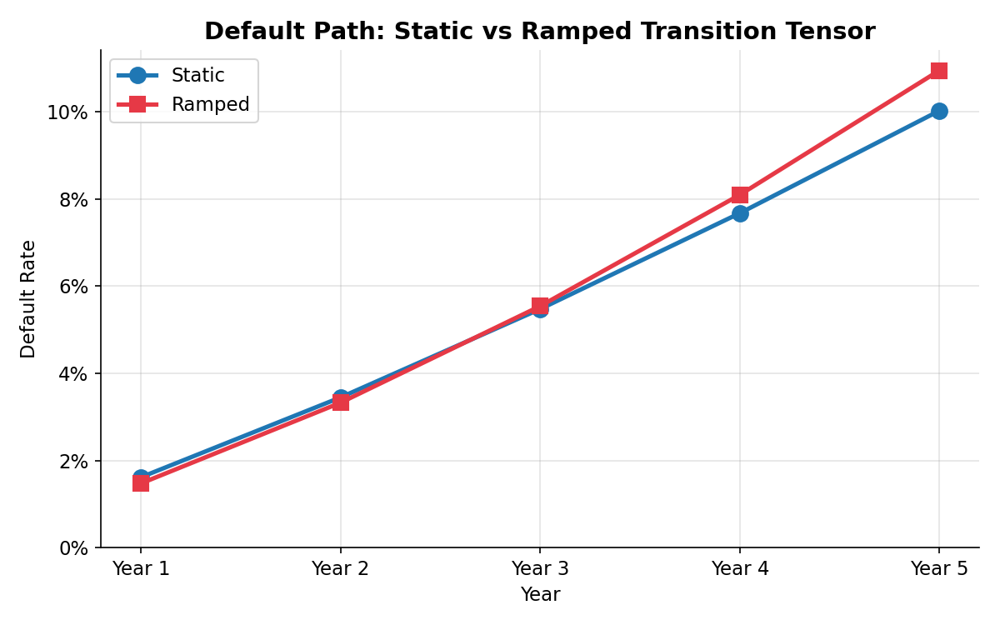
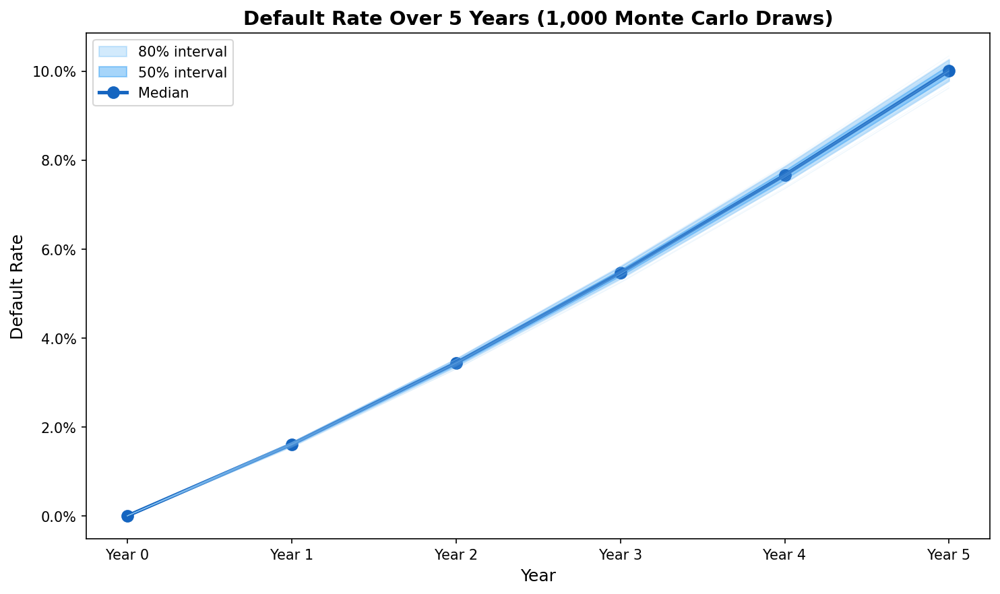
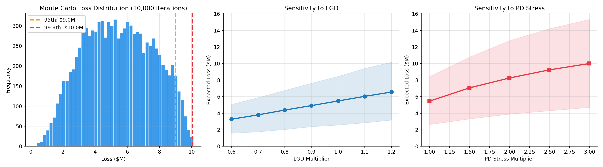
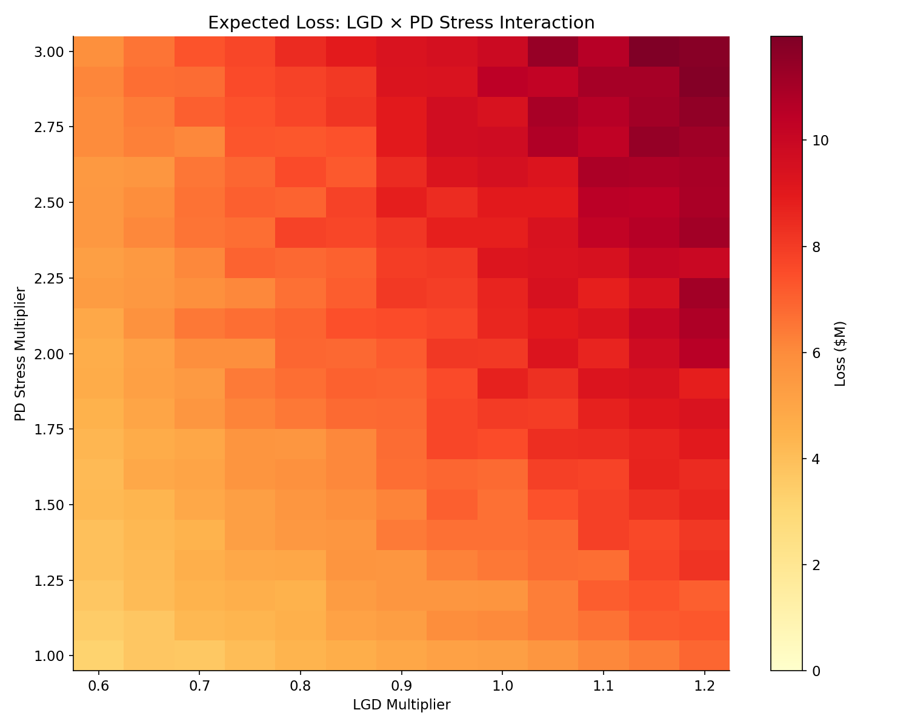

# Compiled Markov Chains for Credit Risk in Python

!!! tip "TL;DR"
    Python has hundreds of credit risk repositories. Almost all do credit scoring (ML). Almost none do credit migration (Markov chains + simulation + sensitivity). Here's how to build a compiled credit migration model using PyTensor and PyMC, with auto-discovered sensitivity parameters that sweep without recompilation, and where any tensor that broadcasts (a per-year stress profile, a macro overlay) composes into the same compiled function.

## The Problem

When a bank holds $100M in corporate bonds, it needs to answer a hard question: "What happens to our portfolio if the economy worsens over the next 5 years?"

The standard approach is **credit migration**: tracking how borrowers move between rating categories over time. In normal economic conditions, nearly 10% of a corporate bond portfolio defaults within 5 years. That's $10M in losses, and that's *before* a recession hits.

Python has [hundreds of credit risk repositories](https://github.com/topics/credit-risk?l=python), but almost all do **credit scoring**: predicting whether an individual borrower will default. Credit *migration* is a different problem: simulating how an entire portfolio evolves over time, with parameter uncertainty and sensitivity analysis.

The one Python tool that handles transition matrices, [transitionMatrix](https://github.com/open-risk/transitionMatrix) (87★), does estimation and visualization but not simulation or sensitivity analysis.

Here's how to build what's missing.

## Why Static Graphs Work

The key insight: everything in a risk model is a tensor. Transition matrices, cohort vectors, recovery rates, costs. If everything is a tensor, you can compose it into a single computation graph. And if you have a computation graph, you can compile, optimize, and introspect it.

Here is a five-year Markov scan, and what the compiler does with it:

```python
import pytensor
import pytensor.tensor as pt

x = pt.vector("x")
T = pt.matrix("T")

def step(x_t, T):
    return x_t @ T

trace = pytensor.scan(
    fn=step,
    outputs_info=[x],
    non_sequences=[T],
    n_steps=5,
    return_updates=False,
)

fn = pytensor.function([x, T], trace)
fn.dprint()
```

``` title="Compiled graph (from dprint)"
Subtensor{start:} [id A] 6
 ├─ Scan{scan_fn, while_loop=False, inplace=all} [id B] 5
 │  ├─ 5 [id C]
 │  ├─ SetSubtensor{:stop} [id D] 4
 │  │  ├─ AllocEmpty{dtype='float64'} [id E] 3
 │  │  │  ├─ 6 [id F]
 │  │  │  └─ Shape_i{0} [id G] 2
 │  │  │     └─ x [id H]
 │  │  ├─ ExpandDims{axis=0} [id I] 1
 │  │  │  └─ x [id H]
 │  │  └─ 1 [id J]
 │  └─ MatrixTranspose [id K] 0
 │     └─ T [id L]
 └─ 1 [id J]

Inner graphs:

Scan{scan_fn, while_loop=False, inplace=all} [id B]
 ← Squeeze{axis=1} [id M]
    └─ Dot [id N]
       ├─ i1 [id O] -> [id K]
       └─ ExpandDims{axis=1} [id P]
          └─ i0 [id Q] -> [id D]
```

The inner graph is a single `Dot`: expand the cohort vector to a column, multiply by the transposed matrix, squeeze back. Five interpreted steps become one BLAS call, about 0.006 ms per call for a 7×7 matrix. When the scan also contains embedded distributions that carry random state, `pm.compile` manages their seeds automatically. That's the next section.

## Why PyMC + PyTensor

### Distributions Are Tensors

[PyMC distributions](https://www.pymc.io/projects/docs/en/latest/api/distributions.html) are methods that return `TensorVariable` instances: tensors you can compose with other operations in the computation graph.

```python title="PyMC distributions are tensors"
# This is a tensor, not a number
recovery = pm.Beta.dist(mu=0.45, sigma=0.15)

# You can compose it with other tensors
loss_given_default = 1 - recovery
expected_loss = exposure * default_prob * loss_given_default

# The entire expression is a tensor graph
# Nothing has been computed yet
```

With numpy, `np.random.beta(123, 101)` returns a number immediately. There is no graph, no composition, no compilation.

### pm.compile Creates Seeded Random Functions

[`pm.compile`](https://www.pymc.io/projects/docs/en/latest/api/generated/pymc.pytensorf.compile.html) is not just `pytensor.function`; it automatically manages random seeds across all embedded `pm.*.dist` nodes:

```python title="pm.compile handles random seeds"
import pymc as pm

# Distributions embedded in the graph
cost = pm.Gamma.dist(mu=410, sigma=100)
recovery = pm.Beta.dist(mu=0.45, sigma=0.15)

# pm.compile creates a function that manages random state
fn = pm.compile([], [cost, recovery])

# Each call executes the entire graph, drawing fresh random values
# from every embedded distribution:
result1 = fn()  # draws new Gamma and Beta samples internally
result2 = fn()  # draws NEW, independent samples (not the same as call 1)
print(f"Draw 1: cost={result1[0]:.0f}, recovery={result1[1]:.3f}")
print(f"Draw 2: cost={result2[0]:.0f}, recovery={result2[1]:.3f}")
```

``` title="Output"
Draw 1: cost=539, recovery=0.493
Draw 2: cost=283, recovery=0.746
```

The random state is managed inside the compiled function. No external RNG object, no manual seed passing. Each call is independent.

With numpy, you would manage random state by hand:

```python title="numpy requires manual seed management"
import numpy as np

rng = np.random.default_rng(42)  # create RNG

for _ in range(10000):
    cost = rng.gamma(410, 100)  # pass rng to each call
    recovery = rng.beta(123, 101)
    # ... compute loss ...
```

`pm.compile` eliminates this. The compiled function knows about all random nodes in the graph and updates their seeds automatically.

### The Optimizer Sees the Whole Graph

PyTensor's CVM optimizer inspects the entire computation before running a single operation. It eliminates redundant work, fuses matrix multiplies into BLAS calls, and picks memory layouts that eager execution cannot know about. That's what turned the scan above into a single `Dot`.

## The Three Patterns

### Pattern 1: pm.compile for compiled functions

```python title="pm.compile with embedded distributions"
# Distributions embedded in the model
recovery = pm.Beta.dist(mu=0.45, sigma=0.15)

# ... compose into the loss expression ...
total_loss = defaulted_exposure * (1 - recovery)

# Compile: creates a function that handles all random nodes
fn = pm.compile([], total_loss)

# Each call = one Monte Carlo iteration
results = np.array([fn() for _ in range(10_000)])
```

!!! note "To loop or not to loop?"
    For simple models without `pytensor.scan`, you can vectorize by passing `shape` to each distribution, no loop needed:

    ```python
    # Vectorized: 10,000 draws in one call
    cost = pm.Gamma.dist(mu=35_000, sigma=10_000, shape=10_000)
    recovery = pm.Beta.dist(mu=0.45, sigma=0.15, shape=10_000)
    fn = pm.compile([], cost * recovery)
    results = fn()  # returns array of 10,000 values
    ```

    But when the model contains `pytensor.scan` (like a Markov chain), vectorizing the scan itself is harder. The compiled function handles the scan internally, so you loop over the function instead. The full model below measures ~0.04 ms per call, so 10,000 iterations take under half a second.

### Pattern 2: pt.scalar for sweepable parameters

Name a parameter. It becomes an input to the compiled function:

```python title="pt.scalar for sweepable parameters"
lgd_multiplier = pt.scalar("lgd_multiplier")

# Scale the loss given default (LGD): 0.6x benign, 1.2x harsh
lgd = (1 - recovery) * lgd_multiplier

fn = pm.compile([lgd_multiplier], total_loss)

# Sweep without recompiling (2,000 draws averaged per point)
for mult in np.linspace(0.6, 1.2, 7):
    loss = np.mean([fn(mult) for _ in range(2_000)])
    print(f"LGD {mult:.1f}x → Loss ${loss:>12,.0f}")
```

``` title="Output"
LGD 0.6x → Loss $   3,276,458
LGD 0.7x → Loss $   3,805,973
LGD 0.8x → Loss $   4,383,288
LGD 0.9x → Loss $   4,924,121
LGD 1.0x → Loss $   5,482,240
LGD 1.1x → Loss $   6,040,982
LGD 1.2x → Loss $   6,558,020
```

The relationship is roughly linear: each 0.1x increase in LGD adds ~$550K in expected loss.



### Pattern 3: explicit_graph_inputs for auto-discovery

PyTensor's [`explicit_graph_inputs`](https://github.com/pymc-devs/pytensor/blob/main/pytensor/graph/traversal.py) automatically finds the free parameters in any expression:

```python title="explicit_graph_inputs for auto-discovery"
from pytensor.graph.traversal import explicit_graph_inputs

# Define multiple sweepable parameters
lgd_multiplier = pt.scalar("lgd_multiplier")
pd_stress = pt.scalar("pd_stress")
recovery_senior = pt.scalar("recovery_senior")  # never used below

# ... build the model using lgd_multiplier and pd_stress ...

inputs = sorted(explicit_graph_inputs([total_loss]), key=lambda v: v.name)
print(f"Discovered inputs: {[inp.name for inp in inputs]}")
```

``` title="Output"
Discovered inputs: ['lgd_multiplier', 'pd_stress']
```

Three scalars defined, two discovered. `recovery_senior` never flows into `total_loss`, so the traversal can't see it: defining a parameter is not enough, it has to be part of the computation. The `sorted` call matters too. `explicit_graph_inputs` returns a set, and the compiled function takes positional arguments in input order, so sort by name to keep calls stable.

No manual registration. No rebuilding the model. The graph traversal finds every named `pt.scalar` in the computation and exposes it as a function input.

## Introspecting the Graph

With numpy, operations execute eagerly: each one runs immediately and discards the computation. There is no graph to inspect. With PyTensor, the entire model is a static computation graph that you can query before running.

### Checking for Random Variables

PyMC's [`rvs_in_graph`](https://github.com/pymc-devs/pymc/blob/main/pymc/pytensorf.py#L190) returns the set of random variable nodes in a graph:

```python title="rvs_in_graph: detect uncertainty in the model"
from pymc.pytensorf import rvs_in_graph

# A model with uncertainty: random default rate, random recovery
exposure = 1_000_000
pd = pm.Gamma.dist(mu=0.10, sigma=0.02)
recovery = pm.Beta.dist(mu=0.45, sigma=0.15)
total_loss = exposure * pd * (1 - recovery)

rvs = rvs_in_graph([total_loss])
print(f"Random variables: {len(rvs)}")
print(sorted(map(str, rvs)))

# A deterministic counterpart: fixed default rate, fixed recovery
total_loss_det = exposure * 0.10 * 0.55
print(rvs_in_graph([total_loss_det]))
```

``` title="Output"
Random variables: 2
['beta_rv{"(),()->()"}.out', 'gamma_rv{"(),()->()"}.out']
set()
```

An empty set is falsy, a non-empty set is truthy. That makes this a one-line validation: if you're running a Monte Carlo simulation but `rvs_in_graph` returns an empty set, something is wrong. The model is deterministic and there's no uncertainty to propagate.

### Searching the Graph by Name

[`get_var_by_name`](https://github.com/pymc-devs/pytensor/blob/main/pytensor/graph/traversal.py) finds any named node in a graph. The key detail: a tensor is findable only if you give it a `.name`. A Python variable name is not enough.

```python title="get_var_by_name: search the graph by name"
from pytensor.graph.traversal import get_var_by_name

lgd_multiplier = pt.scalar("lgd_multiplier")
recovery = 0.45 * lgd_multiplier
lgd = 1 - recovery
lgd.name = "lgd"  # naming the tensor is what makes it a landmark

toy_loss = 1_000 * lgd

found = get_var_by_name([toy_loss], "lgd")[0]
print(f"Found: {found.name}")
print(f"Value at multiplier 0.8: {found.eval({lgd_multiplier: 0.8})}")
```

``` title="Output"
Found: lgd
Value at multiplier 0.8: 0.64
```

Named tensors are **landmarks** in complex models. Name the checkpoints you care about while building (in the credit model below: `lgd`, `defaulted_exposure`, `total_loss`), and `get_var_by_name` extracts any of them later from a single compiled function. You don't have to return everything, rebuild the function, or break the computation. Eager execution discards intermediates the moment they're computed; there is nothing to search.

### Summary: Three Functions for Graph Introspection

| Function | What It Finds | Use Case |
|----------|--------------|----------|
| [`explicit_graph_inputs`](https://github.com/pymc-devs/pytensor/blob/main/pytensor/graph/traversal.py) | All free `pt.scalar`/`pt.vector` with no assigned value | Auto-discover sensitivity parameters |
| [`rvs_in_graph`](https://github.com/pymc-devs/pymc/blob/main/pymc/pytensorf.py#L190) | All random variable nodes | Check if model has uncertainty |
| [`get_var_by_name`](https://github.com/pymc-devs/pytensor/blob/main/pytensor/graph/traversal.py) | Any variable by name | Debug, validate, extract specific values |

Together, these give you full introspection of the computation graph, something numpy's eager execution cannot provide.

## Building a Credit Migration Model

### The Setup

Credit migration tracks how borrowers move between ratings over time. A borrower rated BBB today might be upgraded to A or downgraded to BB, depending on their financial trajectory. Each transition has a probability:

| From \ To | AAA | AA | A | BBB | BB | B | D |
|-----------|-----|----|----|-----|----|---|---|
| **AAA** | 87.3% | 8.9% | 3.4% | 0.4% | 0.1% | 0.0% | 0.0% |
| **AA** | 0.1% | 87.8% | 9.6% | 1.8% | 0.5% | 0.2% | 0.0% |
| **A** | 0.0% | 1.3% | 87.0% | 9.6% | 1.5% | 0.5% | 0.1% |
| **BBB** | 0.0% | 0.1% | 2.5% | 85.7% | 9.1% | 2.4% | 0.3% |
| **BB** | 0.0% | 0.0% | 0.1% | 3.4% | 80.1% | 11.4% | 5.0% |
| **B** | 0.0% | 0.0% | 0.0% | 0.2% | 3.5% | 76.3% | 20.0% |
| **D** | 0.0% | 0.0% | 0.0% | 0.0% | 0.0% | 0.0% | 100% |

Most borrowers stay in their current rating (the diagonal). The off-diagonal elements show upgrades (above diagonal) and downgrades (below diagonal). Default (D) is absorbing: once you default, you stay defaulted.

Banks use transition matrices to project portfolio composition and compute RWA (risk-weighted assets), ECL (expected credit losses under the IFRS 9 provisioning standard), and stress test results.

### The Transition Matrix

Use [`pm.Dirichlet.dist`](https://www.pymc.io/projects/docs/en/latest/api/distributions/generated/pymc.Dirichlet.html) for Bayesian uncertainty in transition probabilities:

```python title="Transition matrix with Dirichlet posteriors"
import numpy as np
import pymc as pm
import pytensor.tensor as pt

RATINGS = ["AAA", "AA", "A", "BBB", "BB", "B", "D"]
DEFAULT_IDX = 6

# Historical transition counts (Moody's data)
# Each row = transitions FROM that rating TO [AAA, AA, A, BBB, BB, B, D]
counts = {
    "AAA": [8744, 889, 336, 41, 7, 3, 0],
    "AA":  [6, 8749, 959, 181, 46, 24, 3],
    "A":   [2, 128, 8676, 961, 150, 52, 5],
    "BBB": [1, 5, 244, 8516, 900, 236, 33],
    "BB":  [0, 2, 8, 335, 7910, 1123, 498],
    "B":   [0, 0, 3, 18, 345, 7634, 2000],
}

# One Dirichlet per living rating: all rows drawn at once
T_nondefault = pm.Dirichlet.dist(np.array(list(counts.values())))  # (6, 7)

T = pt.zeros((7, 7))
T = pt.set_subtensor(T[:6], T_nondefault)

# Pin the absorbing state (default → default = 1.0)
T = pt.set_subtensor(T[DEFAULT_IDX], [0.0, 0.0, 0.0, 0.0, 0.0, 0.0, 1.0])
```

`pm.Dirichlet.dist` with a 2D concentration matrix draws all rows simultaneously. Each row is an independent Dirichlet sample; the rows don't interact. The default row never enters the Dirichlet. Default is absorbing, so there is nothing to estimate: the row is pinned to the identity with `set_subtensor`.

### The Markov Trace

Use [`pytensor.scan`](https://pytensor.readthedocs.io/en/latest/library/scan.html) to iterate the cohort through the transition matrix:

```python title="Markov trace via pytensor.scan"
# Initial portfolio (fractions by rating)
cohort0 = pt.as_tensor_variable([0.05, 0.15, 0.40, 0.25, 0.10, 0.05, 0.00])

# Scan: iterate cohort @ T for 5 years
def step(cohort_t, T):
    return cohort_t @ T

trace = pytensor.scan(
    fn=step,
    outputs_info=[cohort0],
    non_sequences=[T],
    n_steps=5,
    return_updates=False,
)

# trace shape: (5, 7), i.e. 5 years × 7 ratings
```

Each step multiplies the cohort vector by the transition matrix. The result is a trace showing how the portfolio evolves:

| Year | AAA | AA | A | BBB | BB | B | D (Default) |
|------|-----|----|----|-----|----|---|-------------|
| 0 | 5.0% | 15.0% | 40.0% | 25.0% | 10.0% | 5.0% | 0.0% |
| 1 | 4.4% | 14.1% | 37.0% | 25.9% | 11.1% | 5.8% | 1.6% |
| 2 | 3.8% | 13.3% | 34.4% | 26.5% | 12.1% | 6.5% | 3.4% |
| 3 | 3.4% | 12.5% | 32.0% | 26.7% | 12.9% | 7.2% | 5.5% |
| 4 | 3.0% | 11.7% | 29.8% | 26.6% | 13.5% | 7.8% | 7.7% |
| 5 | 2.6% | 10.9% | 27.8% | 26.4% | 14.0% | 8.3% | **10.0%** |

**What the numbers show:**
- AAA shrinks from 5.0% to 2.6%: half the AAA borrowers are downgraded over 5 years
- Default grows from 0% to **10.0%**
- BBB is relatively stable (25.0% → 26.4%): upgrades and downgrades roughly balance
- Speculative grade (BB+B) grows from 15% to 22.3%: borrowers fall into riskier categories



That 10% five-year default rate is why banks hold capital reserves.

### A Time-Varying Transition Tensor

The scan above iterates a static matrix, but nothing about it requires one. Hand it a tensor of shape (5, 7, 7), one matrix per year, and the same composition, compilation, and introspection work unchanged. Suppose stress builds over the horizon. IFRS 9 ECL accounting expects exactly that: provisions must reflect forward-looking macro conditions, not one average scenario:

```python title="Time-varying transitions: same scan, stacked tensor"
# Per-year PD stress profile: benign early, stressed late
pd_ramp = pt.as_tensor_variable([0.9, 1.0, 1.1, 1.2, 1.3])

# Stack the same posterior draw into a (5, 7, 7) tensor
T_stack = pt.stack([T] * 5)
col = T_stack[:, :, DEFAULT_IDX] * pd_ramp[:, None]     # broadcasts over ratings
T_stack = pt.set_subtensor(T_stack[:, :, DEFAULT_IDX], col)
T_stack = T_stack / T_stack.sum(axis=2, keepdims=True)  # renormalize each year

# Scan passes sequence items first, so the step signature flips
def step(T_t, cohort_t):
    return cohort_t @ T_t

trace = pytensor.scan(
    fn=step,
    outputs_info=[cohort0],
    sequences=[T_stack],
    n_steps=5,
    return_updates=False,
)
```

!!! note "Scan argument order is a trap"
    Scan passes sequence items before output taps. Get the signature backwards and the model still runs, but it silently computes the transposed dynamics. This is where named variables pay off: `T_stack.name = "T_stack"`, `trace.name = "trace"`, then `get_var_by_name` fetches them and `eval()` proves the internals (rows sum to 1 in every year, cohort conserved). The debugging tool is the same one the post is selling.

The ramp shifts the default path year by year:

| Year | Static | Ramped |
|------|--------|--------|
| 1 | 1.6% | 1.5% |
| 2 | 3.4% | 3.3% |
| 3 | 5.5% | 5.5% |
| 4 | 7.7% | 8.1% |
| 5 | 10.0% | **10.9%** |



The five-year default rate rises from 10.0% to 10.9%, and mean loss from $5.47M to $5.97M. The profile `pd_ramp` is just a tensor: scale it by a `pt.scalar`, drive it from macro data, or draw it from a posterior, and the same compiled function accepts it. If it broadcasts through the graph, it composes.

### Seeing the Uncertainty

The deterministic trace shows one possible outcome. But transition probabilities are estimated from historical data: there's uncertainty in every cell of the matrix. Here's what happens when we sample 1,000 different transition matrices from the Dirichlet posterior:

```python title="1,000 Monte Carlo draws from Dirichlet posteriors"
default_rate_path = trace[:, DEFAULT_IDX]  # per-year default rate

fn = pm.compile([], default_rate_path)
draws = np.array([fn() for _ in range(1_000)])  # (1_000, 5)
```

Each call draws a fresh transition matrix from the Dirichlet posterior. The result:



With 10,000+ observations per transition (Moody's data), the uncertainty is tight: the 80% interval for the five-year default rate spans 9.8% to 10.3%. For a $100M portfolio, that's a $500K range in expected losses. In stress scenarios with fewer observations, the intervals widen considerably.

### The Cost Model

Recovery rates vary by seniority. Use [`pm.Mixture.dist`](https://www.pymc.io/projects/docs/en/latest/api/distributions/mixture.html) for the portfolio-weighted average:

```python title="Recovery rates with mixture distribution"
PORTFOLIO_VALUE = 100_000_000

senior_secured = pm.Beta.dist(mu=0.60, sigma=0.15)
senior_unsecured = pm.Beta.dist(mu=0.45, sigma=0.20)
subordinated = pm.Beta.dist(mu=0.25, sigma=0.15)

# Portfolio-weighted mixture
recovery = pm.Mixture.dist(
    w=[0.30, 0.50, 0.20],
    comp_dists=[senior_secured, senior_unsecured, subordinated],
)

# Loss given default
lgd = 1 - recovery

# Total loss = defaulted exposure × LGD
defaulted_exposure = trace[-1, DEFAULT_IDX] * PORTFOLIO_VALUE
total_loss = defaulted_exposure * lgd
```

### Compile and Run

```python title="Compile and run Monte Carlo"
fn = pm.compile([], total_loss, random_seed=42)

# Run 10,000 Monte Carlo iterations
results = np.array([fn() for _ in range(10_000)])

print(f"Mean loss:         ${results.mean():>12,.0f}")
print(f"95th percentile:   ${np.percentile(results, 95):>12,.0f}")
print(f"99.9th percentile: ${np.percentile(results, 99.9):>12,.0f}")
```

``` title="Output"
Mean loss:         $   5,466,093
95th percentile:   $   8,983,831
99.9th percentile: $  10,022,964
```

With `random_seed` set, every rerun reproduces these numbers exactly, which is what model validation asks for. The mean is the expected loss; the distance from the mean to the 99.9th percentile, about $4.56M here, is the unexpected loss that capital has to absorb.

The histogram below shows the full loss distribution. The 95th and 99.9th percentiles mark the tail risk that regulators care about:



## Sensitivity Analysis

### The Problem

Banks need to sweep parameters to understand sensitivity. How does RWA change if LGD increases? What if default rates double under stress? In SAS or Excel, each sweep requires rebuilding the model.

### The Solution

PD (probability of default) stress scales the default column of the transition matrix. After scaling, the rows are renormalized so the matrix stays stochastic:

```python title="Sensitivity analysis with pt.scalar"
pd_stress = pt.scalar("pd_stress")

# Scale the default column, then renormalize rows
col = T[:, DEFAULT_IDX] * pd_stress
T_stressed = pt.set_subtensor(T[:, DEFAULT_IDX], col)
T_stressed = T_stressed / T_stressed.sum(axis=1, keepdims=True)

# ... rebuild the trace with T_stressed ...

fn = pm.compile([pd_stress], total_loss)

# 2,000 draws averaged per point
for stress in [1.0, 1.5, 2.0, 2.5, 3.0]:
    loss = np.mean([fn(stress) for _ in range(2_000)])
    print(f"PD {stress:.1f}x → Loss ${loss:>12,.0f}")
```

``` title="Output"
PD 1.0x → Loss $   5,461,141
PD 1.5x → Loss $   7,067,245
PD 2.0x → Loss $   8,256,315
PD 2.5x → Loss $   9,241,507
PD 3.0x → Loss $  10,005,035
```

!!! warning "Keep the matrix stochastic"
    Scaling the default column without renormalizing the rows breaks the transition matrix: rows no longer sum to one, and the sweep will happily report losses larger than the portfolio itself. Renormalize after scaling.

Where the LGD sweep (Pattern 2) is roughly linear, PD stress is sublinear: speculative-grade default probabilities saturate as the multiplier grows, so each extra unit of stress buys less. At 3x stress, losses still double, from ~$5.5M to $10M.

The two-way heatmap shows how LGD and PD stress interact:



No recompilation. No rebuilding the model. The same compiled function handles both the Monte Carlo run and the sensitivity sweeps.

## Why This Matters

### The Paradigm, Not Just Speed

For a simple 7×7 matrix multiply, numpy is actually faster: no graph overhead, direct BLAS call. The PyTensor advantage is not raw speed for simple operations. It's the **paradigm**:

| Capability | numpy loop | PyTensor compiled |
|-----------|-----------|------------------|
| Matrix-vector multiply | Direct BLAS (fastest) | Dot via scan (slight overhead) |
| Embedded distributions | Manual seed management | Automatic via `pm.compile` |
| Composition of distributions | Not possible | Tensors compose into graph |
| Sensitivity analysis | Rebuild model for each parameter | Auto-discovered, no recompilation |
| Graph optimization | None | CVM fuses operations |

With numpy you'd manage random state for each distribution, compose the pieces yourself, and rebuild the model for every sensitivity parameter. The engineering win is not raw speed on toy graphs; it is never writing that plumbing by hand.

### The Flexibility

| Capability | numpy/scipy | PyMC + PyTensor |
|-----------|------------|-----------------|
| Distributions | 20+ in scipy | 50+ in PyMC, vectorized |
| Meta-distributions | Manual implementation | Mixture, Truncated, RandomWalk built-in |
| Compilation | Not possible | pm.compile to C |
| Sensitivity analysis | Manual parameter passing | Auto-discovered via graph introspection |
| Time-varying parameters | Manual reshaping and relooping | (horizon, ...) tensor broadcasts into the same scan |
| MCMC integration | Manual resampling | Categorical index over draws, inside the compiled graph |

### The Integration

PyMC distributions are the bridge between inference and simulation. You can:

1. **Fit a Bayesian model** to historical data (MCMC)
2. **Stack the posterior draws** into a numpy array, shape (n_draws, n_params)
3. **Index the stack from inside the graph**: a `pm.Categorical.dist` over draw indices, sliced against the stacked array, is one tensor per parameter
4. **Compile** the whole pipeline: each call picks one posterior-consistent parameter set and runs the model

```python title="Posterior draws as an embedded distribution"
# posterior_draws: numpy array, shape (n_draws, 2)
n = posterior_draws.shape[0]
idx = pm.Categorical.dist(p=np.full(n, 1 / n))
stacked = pt.as_tensor_variable(posterior_draws)
alpha = stacked[:, 0][idx]
beta = stacked[:, 1][idx]

# alpha and beta share the index: each call is one joint posterior draw
fn = pm.compile([], total_loss)  # with alpha and beta woven into the loss
for _ in range(10_000):
    result = fn()
```

A `Categorical` index over draws is just another embedded distribution; `pm.compile` manages its randomness like every other node. The result is one compiled function that runs the fitted model, posterior uncertainty included.

With numpy there is no graph to compose into. Each draw executes immediately, and the connection between inference and simulation is glue code you maintain by hand.

## Reproducibility

Every number and figure in this post comes from committed scripts in `docs/blog/posts/scripts/compiled-markov-credit-risk/`:

- `credit_model.py`: the shared model (transition matrix, scan, recovery mixture)
- `verify_snippets.py`: rebuilds the model and prints every output block shown above
- `make_figures.py`: regenerates every figure

```bash
uv run docs/blog/posts/scripts/compiled-markov-credit-risk/verify_snippets.py
uv run docs/blog/posts/scripts/compiled-markov-credit-risk/make_figures.py
```

## What's Missing

The gap from The Problem is real: estimation tools exist, compiled simulation does not. The building blocks exist (PyMC, PyTensor). The application (credit risk) is well-defined. The combination just hasn't been built (at least not as a standard, reusable Python package).

The model itself has limits worth naming:

- **Default correlation**: one shared transition-matrix draw correlates obligors within a rating, but a real portfolio needs a systematic factor hitting every rating at once; the standard machinery is the Vasicek one-factor model and copulas, the structures behind regulatory capital formulas
- **Downturn LGD**: recovery is drawn independently of the economic state; in reality recoveries fall in recessions
- **Discounting and staging**: IFRS 9 ECL is discounted and staged (12-month vs lifetime losses); both read straight off the trace the model already returns
- **Validation**: the Dirichlet posteriors need backtesting against realized migrations

The time-varying tensor is the seam where most of these plug in: a systematic factor scaling the stress profile, a downturn multiplier on recovery, a discount vector over the horizon. Same pattern, same compiled function.

## What's Next

This post demonstrates the paradigm on credit migration. The same patterns apply to:

- **Insurance**: claim frequency/severity simulation with Bayesian posteriors
- **Healthcare**: Markov cohort models for cost-effectiveness analysis
- **Airport revenue**: parking demand forecasting with parameter uncertainty
- **Equipment maintenance**: failure prediction with Weibull distributions

If you're working on credit risk in Python and want to discuss this approach, [let me know](https://www.linkedin.com/in/williambdean/).
