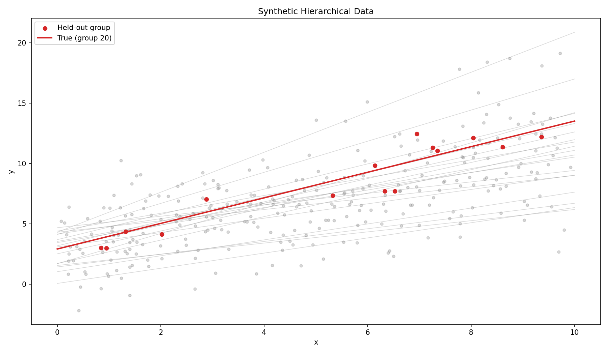
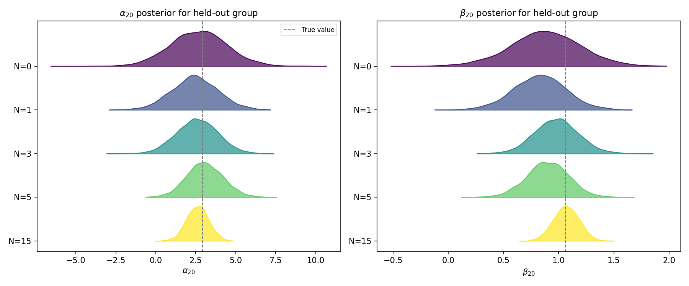

# Predicting for New Groups in Hierarchical Models

You have a hierarchical (multilevel) model fit to data from several groups. A new group comes along. Maybe you have no observations for it yet. Maybe you have one. Maybe a handful. How should you predict?

This post walks through the practical workflow, covering:

- **No data** — the prediction comes entirely from the population distribution
- **One data point** — a single observation starts to pull the estimate toward the group
- **A handful of data points** — partial pooling in action
- **A full set of data** — the estimate converges to the group-specific solution

Along the way we compare the hierarchical approach against two non-hierarchical baselines to see exactly what the partial pooling buys you.

## Why Not "Update Priors?"

A natural first thought: fit the model on the existing groups, then use the posterior as a prior for the new group. The PyMC docs have a popular [example of this approach](https://www.pymc.io/projects/examples/en/latest/howto/updating_priors.html) using KDE-based `pm.Interpolated` distributions. But the "Words of Caution" section there and [a deeper treatment by Oriol Abril](https://oriolabrilpla.cat/en/blog/posts/2022/too-eager-reduction.html#univariate-priors) explain why this is a bad idea: the KDE approximation discards correlations between parameters. What you need is the *joint* posterior, not a product of univariate marginals. A [PyMC discourse thread](https://discourse.pymc.io/t/how-to-use-the-posterior-distribution-of-one-model-as-a-prior-distribution-for-another-model/13956) discusses multivariate alternatives like `prior_from_idata`, but the honest recommendation (from the thread and the docs) is: **just refit**.

For hierarchical models, there is a simpler path that avoids the problem entirely. Since the group-level parameters already share a common population distribution, you don't need to "move" the posterior anywhere. You build the same model structure with all groups (including the future one) and refit with different subsets of data. The same graph, just different data slices.

## The Hierarchical Model

We use a random-intercept, random-slope linear regression:

$$
\begin{aligned}
y_i &\sim \mathcal{N}(\alpha_{g[i]} + \beta_{g[i]} x_i, \sigma^2) \\
\alpha_g &\sim \mathcal{N}(\mu_\alpha, \sigma^2_\alpha) \\
\beta_g &\sim \mathcal{N}(\mu_\beta, \sigma^2_\beta)
\end{aligned}
$$

where $g[i]$ indexes the group of observation $i$. The population parameters $\mu_\alpha, \mu_\beta, \sigma_\alpha, \sigma_\beta$ are shared across all groups. This structure naturally handles our scenarios: a group with no observed data still gets parameter estimates from the population distribution, and a group with some data gets a partial-pooling compromise.

## Synthetic Data

Twenty groups, fifteen observations each, generated from known parameters. Group 20 is held out from the initial fit.

```python title="Generate synthetic data"
import numpy as np

rng = np.random.default_rng(42)

n_groups = 20
n_per_group = 15
held_out = 19  # zero-indexed, group 20

# True population parameters
mu_alpha_true, sigma_alpha_true = 3.0, 1.5
mu_beta_true, sigma_beta_true = 0.8, 0.4
sigma_true = 1.5

alpha_true = rng.normal(mu_alpha_true, sigma_alpha_true, n_groups)
beta_true = rng.normal(mu_beta_true, sigma_beta_true, n_groups)

X = rng.uniform(0, 10, (n_groups, n_per_group))
y = np.zeros_like(X)
for g in range(n_groups):
    y[g] = alpha_true[g] + beta_true[g] * X[g] + rng.normal(0, sigma_true, n_per_group)

groups = np.repeat(np.arange(n_groups), n_per_group)
x_flat, y_flat = X.ravel(), y.ravel()
held_out_mask = groups == held_out
```

The held-out group has $\alpha_{20} = 2.93$ (near the population mean of 3.0) and $\beta_{20} = 1.06$ (above the population mean of 0.8). The slope will be the harder parameter to recover from sparse data.



## The Workflow: Same Model, Different Data

The same model structure is used for each scenario. A helper function builds the model with all 20 groups in the coordinate system:

```python title="Hierarchical model with all groups"
import pymc as pm

def build_model(group_idx, x, y):
    with pm.Model(coords={"group": np.arange(n_groups)}) as model:
        # Population-level hyperpriors
        mu_alpha = pm.Normal("mu_alpha", 0, 5)
        sigma_alpha = pm.HalfNormal("sigma_alpha", 2.5)
        mu_beta = pm.Normal("mu_beta", 0, 5)
        sigma_beta = pm.HalfNormal("sigma_beta", 2.5)

        # Group-level parameters (all 20 groups)
        alpha = pm.Normal("alpha", mu_alpha, sigma_alpha, dims="group")
        beta = pm.Normal("beta", mu_beta, sigma_beta, dims="group")

        # Observation noise
        sigma = pm.HalfNormal("sigma", 1)

        mu = alpha[group_idx] + beta[group_idx] * x
        pm.Normal("y_obs", mu=mu, sigma=sigma, observed=y)
    return model
```

For each data scenario (0, 1, 3, 5, 15 observations for the held-out group), we build the same model with different training data:

```python title="Fit for each scenario"
ns = [0, 1, 3, 5, 15]
idatas = {}

for n in ns:
    if n == 0:
        mask = ~held_out_mask
    else:
        held_indices = np.where(held_out_mask)[0][:n]
        mask = ~held_out_mask.copy()
        mask[held_indices] = True

    model = build_model(groups[mask].astype(int),
                        x_flat[mask], y_flat[mask])
    with model:
        idatas[n] = pm.sample(draws=1000, tune=1000,
                               nuts_sampler="nutpie", random_seed=42)
```

The key idea: the same model structure with all 20 groups in the coords, just different slices of data. When no data is provided for group 20, the sampler still produces posterior samples for $\alpha_{20}$ and $\beta_{20}$ — they come from the population distribution. When data is added, the sampler partially pools toward the group-specific signal. Because the hyperparameters are already well-characterized from the 19 training groups, each fit converges quickly.

## Scenario A: Zero Data

Before any data, the model has a fixed prior on each group's parameters: $\alpha_g \sim \mathcal{N}(0, 5)$, $\beta_g \sim \mathcal{N}(0, 5)$. Fitting the 19 training groups updates the population-level hyperparameters $\mu_\alpha, \sigma_\alpha, \mu_\beta, \sigma_\beta$, which in turn inform the held-out group's posterior. Because group 20 has no observed data, its parameters are just sampled from the updated population distribution — the sampler draws $\alpha_{20} \sim \mathcal{N}(\mu_\alpha, \sigma_\alpha)$ and $\beta_{20} \sim \mathcal{N}(\mu_\beta, \sigma_\beta)$ without any group-specific constraint.


The contrast is dramatic: the prior is essentially flat across the relevant range, while the posterior concentrates around the population means ($\mu_\alpha \approx 3.0$, $\mu_\beta \approx 0.8$). The posterior for $\alpha_{20}$ is centered close to the true value (2.93), and the posterior for $\beta_{20}$ is centered at 0.8 — biased low relative to the true 1.06. That is expected and correct: with no information about this specific group, the best guess is the average group. The uncertainty interval is wide enough to contain the truth.

## Scenario B: Sparse Data

As we add observations, the posterior for $\alpha_{20}$ and $\beta_{20}$ shifts from the population distribution toward their true values. The plot below shows the evolution.



Reading top to bottom, the pattern is clear:

- **N=0** — posterior centered on the population mean, wide uncertainty
- **N=1** — a single observation starts the shift; the slope posterior begins moving toward 1.06. The uncertainty is still large because one point cannot pin down both an intercept and a slope
- **N=3** — the slope posterior tightens considerably
- **N=5** — both parameters approaching their true values
- **N=15** — the posterior converges close to the group-specific OLS estimate, with uncertainty reflecting the noise around the regression line

The intercept moves less dramatically because it starts near the truth ($\alpha_{20} = 2.93$ vs $\mu_\alpha = 3.0$). The slope shows more evolution because the prior mean (0.8) was further from the truth (1.06).

## Comparison with Baselines

Two non-hierarchical models provide contrast:

- **Pooled** — a single regression $y_i \sim \mathcal{N}(\alpha + \beta x_i, \sigma^2)$ ignoring groups entirely. This gives one prediction for all groups, underfitting the group structure.
- **Unpooled (no pooling)** — independent priors per group, no shared population distribution:

```python
def build_unpooled_model(group_idx, x, y):
    with pm.Model(coords={"group": np.arange(n_groups)}) as model:
        alpha = pm.Normal("alpha", 0, 5, dims="group")
        beta = pm.Normal("beta", 0, 5, dims="group")
        sigma = pm.HalfNormal("sigma", 1)
        mu = alpha[group_idx] + beta[group_idx] * x
        pm.Normal("y_obs", mu=mu, sigma=sigma, observed=y)
    return model
```

The unpooled model has the same structure but without the population-level hyperpriors. Each group's parameters are independent, regularized only by the fixed priors $\alpha_g \sim \mathcal{N}(0, 5)$ and $\beta_g \sim \mathcal{N}(0, 5)$. For a held-out group with no data, this reverts to the prior — a prediction centered at zero with enormous uncertainty. With sparse data, the estimates are noisy because there is no borrowing of strength across groups.

The hierarchical model splits the difference: it uses the population distribution to regularize groups with sparse data while still allowing each group to deviate from the population mean.


The faceted view makes the progression clear:

- **No data** — the hierarchical prediction sits near the population mean with a wide but honest credible interval. The unpooled model reverts to its prior, predicting a flat line at zero. The pooled model gives its single global prediction. The unpooled CI (faint orange shading) fills the entire plot — the prior is too vague to constrain the prediction at all.
- **1 observation** — a single point begins pulling the hierarchical prediction upward with wide uncertainty. The unpooled model shifts away from zero but the uncertainty is still enormous (one point cannot identify both intercept and slope). The CI is dramatically wider than the hierarchical model's.
- **3 observations** — the hierarchical prediction tightens considerably. The unpooled prediction is closer to the true line but still shows wider uncertainty than the hierarchical one, reflecting the lack of regularization.
- **5 observations** — both hierarchical and unpooled predictions approach the true line. The unpooled CI remains wider because it does not borrow strength from other groups.
- **15 observations** — both models converge to similar predictions. With enough data, the data overwhelms both the hierarchical prior and the unpooled fixed prior, and the two models agree.

## Key Takeaways

### The Workflow

Build the model once with all groups in the coordinate system. Refit with different subsets of the data to control how many observations the held-out group contributes. No posterior-as-prior manipulation, no KDE approximations, no correlation loss. The hierarchical structure *is* the mechanism that connects zero-data to full-data prediction.

### When It Matters Most

- **New groups with zero data**: the hierarchical model provides a sensible prediction from the population distribution, with honest uncertainty. No frequentist alternative offers this without some ad-hoc shrinkage.
- **New groups with one observation**: you cannot estimate a slope and intercept from a single point, but the hierarchical model borrows strength from the population to make a regularized prediction. The uncertainty is wide but honest.
- **New groups with a handful of observations**: partial pooling still helps. The prediction is shrunk toward the population mean, reducing variance at the cost of a small bias.

### Limitations

The independent Normal priors on $\alpha_g$ and $\beta_g$ used here assume no correlation between intercepts and slopes at the group level. In real applications, a multivariate Normal (MvNormal) with a correlation parameter is often more appropriate. The same workflow applies — just replace the two independent Normals with a single `pm.MvNormal`.

Also note that we refit for each data scenario. For small models this is fast, but for large models a full MCMC run per scenario may be impractical.

## Further Reading

- PyMC documentation on [`pm.Data` and `set_data`](https://www.pymc.io/projects/docs/en/stable/api/generated/pymc.set_data.html)
- PyMC example: [Updating Priors](https://www.pymc.io/projects/examples/en/latest/howto/updating_priors.html) — with Words of Caution about univariate KDE approximations
- Oriol Abril: [Some Dimensionality Devils](https://oriolabrilpla.cat/en/blog/posts/2022/too-eager-reduction.html#univariate-priors) — why univariate priors lose joint posterior structure
- PyMC Discourse: [Using posterior as prior](https://discourse.pymc.io/t/how-to-use-the-posterior-distribution-of-one-model-as-a-prior-distribution-for-another-model/13956) — discussion of alternatives and recommendations
- Gelman & Hill (2006). *Data Analysis Using Regression and Multilevel/Hierarchical Models*. Cambridge University Press.

## Reproducibility

All figures are generated by a single script:

```bash
uv run docs/blog/posts/scripts/hierarchical-group-predictions/generate_figures.py
```

The script is self-contained with inline PEP 723 dependencies. It generates the synthetic data, fits all models, and produces the four figures used in this post.
